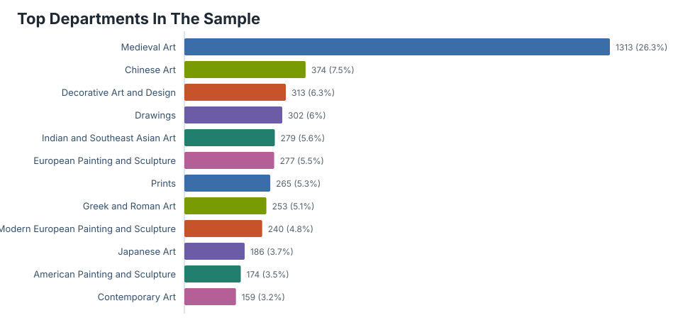
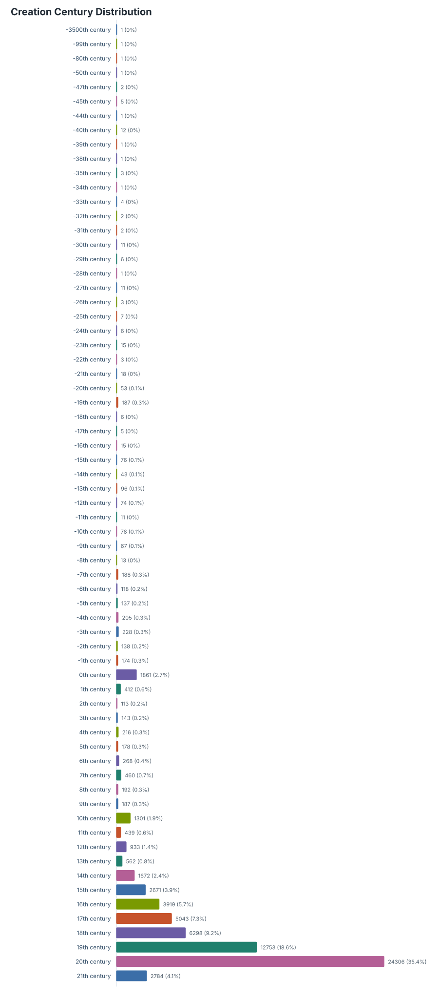
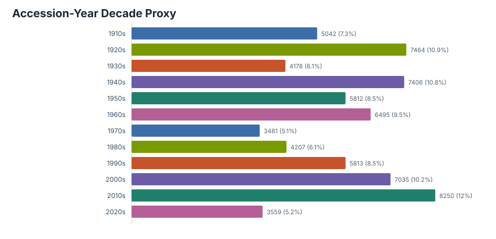
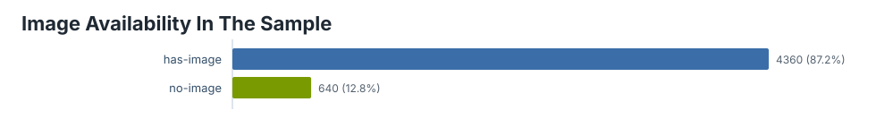

# What A Museum Collection Looks Like When It Becomes Data

Status: publication draft for editorial review

Source artifact: `docs/experiments/cleveland-museum-collection-shape/reports/result.json`

Audit packet: `docs/experiments/cleveland-museum-collection-shape/reports/audit-packet.md`

Evidence audit: `docs/experiments/cleveland-museum-collection-shape/reports/post-evidence-audit.json`

## Thesis

A museum collection is usually encountered one object at a time: a painting on a wall, a sculpture in a gallery, a record in a search box. An open collection API changes the unit of attention. It lets the collection become a table.

Departments, dates, object types, rights, image availability, provenance coverage, and acquisition patterns can all be inspected at once. That does not make the dataset neutral. It makes the structure visible enough to question.

This essay uses a full-source corpus from the Cleveland Museum of Art Open Access API to show what becomes visible when a museum collection is structured enough to analyze. Cleveland does not stand for all museums. The point is more specific: a public API turns one collection into a measurable cultural object, with new possibilities and new caveats.

## Corpus Note

The current run fetched 68,742 artwork records from 68,743 total API records, or effectively 100.0% of the available collection metadata at collection time. The one-record delta is preserved as an API pagination caveat rather than silently rounded away.

Each row is one artwork metadata record. The processed table includes department, collection, object type, culture, creation dates, accession-number year, explicit accession date where present, license status, image availability, credit line, and provenance-entry count.

The audit packet reviewed 78 rows and flagged 47,636 rows for caveats such as accession-year mismatches, missing images, or missing provenance entries. Those flags are not failures. They are reminders about what the metadata can and cannot support.

## Finding 1: The Collection Has A Visible Department Shape

In the full-source corpus, the largest department is Prints, with 21,155 records, or 30.8% of rows. The next largest departments are Photography, Drawings, Textiles, and Decorative Art and Design.

Department counts are not a neutral measure of cultural importance. They reflect collection history, cataloging practice, department boundaries, and what is available through the API. But they are a useful first map of the dataset's internal structure.

## Finding 2: Object Dates Cluster Across Very Different Time Horizons

The largest creation-century bucket is 20th century, with 24,306 records, or 35.4% of rows. Other large buckets include 19th century, 18th century, 17th century, and 16th century.

A century chart is blunt. It hides uncertainty inside dates such as `circa`, ranges, dynastic periods, and catalog-specific conventions. Still, it gives a fast view of the temporal shape exposed by the metadata.

## Finding 3: Accession Numbers Are Useful, But Risky

The largest accession-year decade proxy in the full corpus is the 2010s, with 8,250 records, or 12.0% of rows. The next largest proxy decades are the 1920s, 1940s, 2000s, and 1960s.

This is explicitly a proxy. The audit packet found 7,739 records where the year extracted from the accession number differs from the explicit accession-date year.

That does not make the proxy useless. It means acquisition-decade claims need manual review before publication, and stronger acquisition-history claims should use explicit acquisition dates where possible.

## Finding 4: Visual Availability Is A Dataset Feature

In the full corpus, 41,444 records have an image, or 60.3%. The remaining 27,298 records do not.

For public humanities work, image availability is not just a convenience. It changes what can be shown, compared, and inspected by readers. A collection can be open as metadata while still uneven as a visual corpus.

## What This Can Support

This artifact can support a first Archive Signals essay about what one open museum collection looks like as structured data.

It can support claims about:

- the full-source Cleveland Museum API corpus
- the fields exposed by the API
- image availability in the full-source corpus
- department, creation-century, and accession-proxy distributions in the full-source corpus
- the methodological difference between object-by-object browsing and collection-level analysis

It should not support claims about museums in general. It should not treat accession-number years as clean acquisition dates without the audit caveat.

## Why This Is A Good First Post

This is a good first public post because the claim is modest and inspectable. It does not need to solve museum history. It only needs to show how the unit of analysis changes when a collection becomes structured data.

That is the broader promise of Archive Signals: not data as a replacement for interpretation, but data as a way to notice structure that ordinary browsing hides.

## What To Study Next

The next version should compare the full Cleveland corpus with another open museum API. It should audit accession-year mismatches before making acquisition-history claims. It should also treat provenance-entry counts as a coverage signal, then design a separate provenance study.

## Reproducibility

- Source: Cleveland Museum of Art Open Access API.
- Raw records: `docs/experiments/cleveland-museum-collection-shape/data/raw/api/2026-06-12/`.
- Processed records: `docs/experiments/cleveland-museum-collection-shape/data/processed/artworks.json` and `docs/experiments/cleveland-museum-collection-shape/data/processed/artworks.csv`.
- Charts: `docs/experiments/cleveland-museum-collection-shape/reports/charts/`.
- Audit packet: `docs/experiments/cleveland-museum-collection-shape/reports/audit-packet.md`.
- Structured findings: `docs/experiments/cleveland-museum-collection-shape/reports/result.json`.
