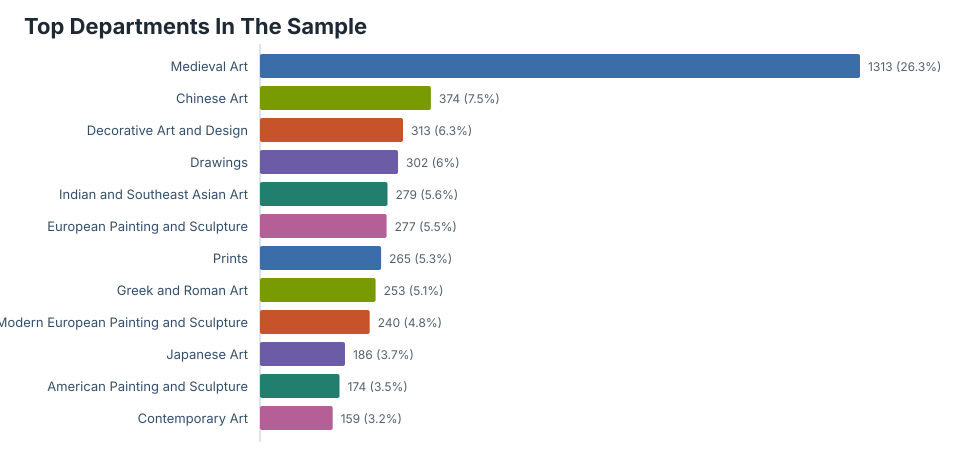
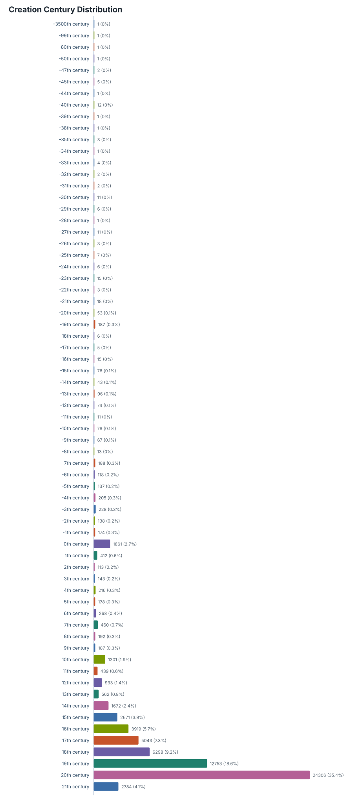
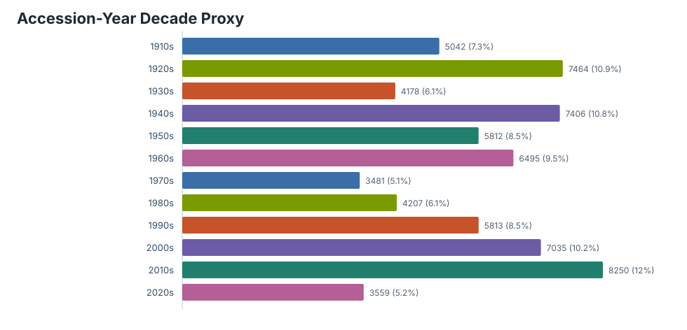
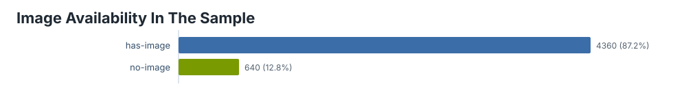

# What A Museum Collection Looks Like When It Becomes Data

A museum collection is usually encountered one object at a time: a painting on a wall, a sculpture in a gallery, a record in a search box. An open collection API changes the unit of attention. It lets the collection become a table: departments, dates, object types, rights, image availability, provenance coverage, and acquisition patterns can all be inspected at once.

This essay uses a bounded sample from the Cleveland Museum of Art Open Access API to show what becomes visible when a museum collection is structured enough to analyze. The point is not that Cleveland stands for all museums. It does not. The point is that a public API turns a collection into a measurable cultural object, with both new possibilities and new caveats.

## Corpus

The current run sampled 68,742 artwork records from 68,743 total API records, or about 100.0% of the available collection metadata. Each row is one artwork metadata record.

The sample includes normalized fields for department, collection, object type, culture, creation dates, accession-number year, explicit accession date where present, license status, image availability, credit line, and provenance-entry count.

## Finding 1: The Collection Has A Visible Department Shape

In this sample, the largest department is Prints, with 21,155 records (30.8% of the sample). The next largest departments are Photography (14.8%), Drawings (7.9%), Textiles (7.6%), and Decorative Art and Design (7.6%).

Department counts are not a neutral measure of cultural importance. They reflect collection history, cataloging practice, department boundaries, and what is available through the API. But they are a useful first map of the dataset's internal structure.

## Finding 2: Object Dates Cluster Across Very Different Time Horizons

The largest creation-century bucket is 20th century, with 24,306 records (35.4%). Other large buckets include 19th century (18.6%), 18th century (9.2%), 17th century (7.3%), and 16th century (5.7%).

A century chart is blunt. It hides uncertainty inside dates such as `circa`, ranges, dynastic periods, and catalog-specific conventions. Still, it gives a fast view of the temporal shape exposed by the metadata.

## Finding 3: Accession Numbers Are Useful, But Risky

The largest accession-year decade proxy in the sample is 2010s, with 8,250 records (12.0%). The next largest proxy decades are 1920s (10.9%), 1940s (10.8%), 2000s (10.2%), and 1960s (9.4%).

This is explicitly a proxy. The audit packet found 7,739 records where the year extracted from the accession number differs from the explicit accession date year, plus 348 record missing an explicit accession year. That does not make the proxy useless, but it means acquisition-decade claims need manual review before publication.

## Finding 4: Visual Availability Is Itself A Dataset Feature

In the sample, 41,444 records have an image (60.3%), while 27,298 do not (39.7%).

For public humanities work, image availability is not just a convenience. It changes what can be shown, compared, and inspected by readers. A collection can be open as metadata while still uneven as a visual corpus.

## What This Can Support

This artifact can support a first public essay about what one open museum collection looks like as structured data. It can support claims about the sampled Cleveland Museum API records, the fields exposed by that API, and the methodological difference between object-by-object browsing and collection-level analysis.

It should not support claims about museums in general. It should not treat the sample as the full Cleveland collection. It should not treat accession-number years as clean acquisition dates without the audit caveat.

## What To Study Next

- Fetch the full collection or a larger paginated corpus.
- Compare the same field map against another open museum API.
- Audit acquisition-year mismatches before making acquisition-history claims.
- Use provenance-entry counts as a coverage signal, then design a separate provenance study.

## Reproducibility

- Source: Cleveland Museum of Art Open Access API.
- Raw records: `data/raw/api/2026-06-12/`.
- Processed records: `data/processed/artworks.json` and `data/processed/artworks.csv`.
- Charts: `reports/charts/`.
- Audit packet: `reports/audit-packet.md`.
- Structured findings: `reports/result.json`.
