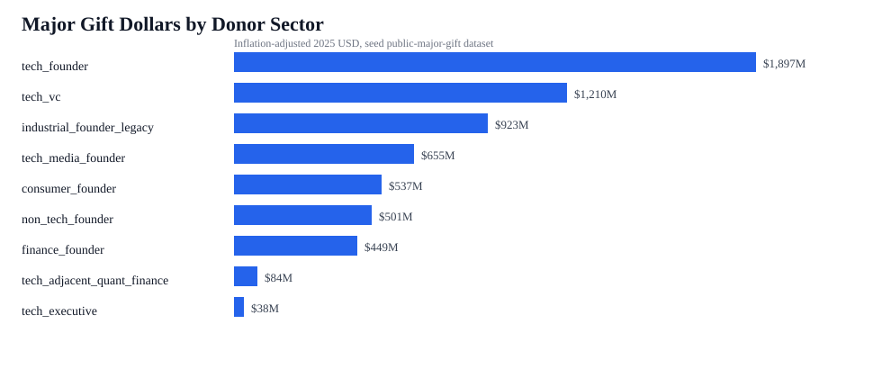
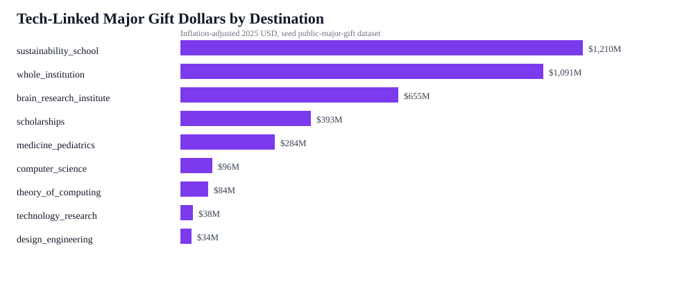
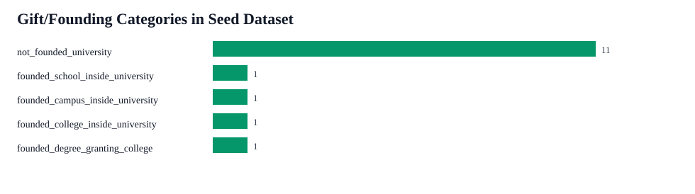

# University Donation Claim Adjudication

## Executive Summary

**Final rating: H2, with substantial H3 support.** The original claim is strongest only under a narrow definition of founding a new independent degree-granting university. It becomes misleading when it implies that tech elites rarely support universities or rarely give university endowments. In this seed public-major-gift dataset, tech-linked donors account for 11 observed major gifts totaling about **$3,882.8 million in 2025 dollars**. Those gifts are heavily concentrated in schools, institutes, computer science, medicine, sustainability, scholarships, buildings, and endowed or unrestricted funds inside existing universities.

The result is not a census of all philanthropy. It is a high-confidence pilot over publicly disclosed major gifts. That data availability constraint matters: this study can test the visible-major-gift version of the claim much better than anonymous gifts, donor-advised-fund gifts, gifts below announcement thresholds, or share-of-net-worth comparisons.

## Original Claim

> Despite being far wealthier in absolute terms than Vanderbilt or Carnegie or Stanford, and being directly positioned in an industry that could benefit from it, no tech elite has ever founded a university, and few have even given endowments.

## Reusable Workflow

1. **Literal claim.** What would have to be true for the sentence to be literally accurate? Output: Atomic empirical claims plus definitional and normative residues.
2. **Implied comparison.** Compared to what baseline? Output: Explicit comparison classes and historical periods.
3. **Hidden denominator.** Few relative to what: people, wealth, total giving, historical precedent, or opportunity? Output: Denominators and rate definitions.
4. **Operational definitions.** What counts and what does not? Output: Inclusion/exclusion rules for donors, gifts, founding, endowments, and university support.
5. **Observable proxies.** What data could represent the claim, even imperfectly? Output: Proxy variables, source classes, and measurement caveats.
6. **Failure modes.** How could the claim be technically true but substantively misleading? Output: Narrow readings, missing data, and rhetorical overreach.
7. **Opposite hypothesis.** What would it look like if reality were backwards? Output: Evidence pattern that would show the claim is false.
8. **Orthogonal hypothesis.** What would it look like if the framing itself were wrong? Output: Evidence pattern showing the old category is not the live institutional form.

## Literal Decomposition

- **C1.** Modern tech elites are richer in absolute or inflation-adjusted terms than Vanderbilt, Carnegie, Stanford, and similar Gilded Age institution builders. Observability: partially_observable. Wealth estimates are available but cross-era net-worth comparisons depend on method and selected comparator set.
- **C2.** Because tech benefits from university research and talent, tech elites are especially positioned to benefit from giving to universities. Observability: partly_normative. Industry dependence is observable, but the “should give” premise is normative and cannot be settled by gift data alone.
- **C3.** No tech elite has founded a university. Observability: highly_observable_for_major_us_degree_granting_cases. Founding an accredited degree-granting university is visible; edge cases include campuses, schools, institutes, online programs, and non-US ventures.
- **C4.** Few tech elites have given endowments to universities. Observability: partially_observable. Public major endowments and named funds are visible; anonymous, donor-advised, below-threshold, and foundation pass-through gifts are incomplete.
- **C5.** Few tech elites donate to universities at all. Observability: observable_only_for_disclosed_major_gifts. This pilot can falsify strong “few donate” rhetoric among public major gifts, but cannot estimate all donations.
- **C6.** Tech giving goes somewhere other than universities. Observability: partially_observable. Can be studied via foundation grants and philanthropic portfolios, but this case study only maps university-side gifts.
- **C7.** Tech elites give differently: restricted, technical, medical, institute, school, and building gifts rather than unrestricted general endowments. Observability: observable_for_public_major_gifts. Purpose and recipient unit are usually visible in major announcements, though restriction details can be vague.

## Definitions

- **tech elite:** Founder, controlling early executive, or venture investor whose wealth and public identity are primarily tied to software, internet, semiconductors, enterprise tech, or adjacent computing infrastructure. The pilot keeps tech founders, tech executives, and tech VCs separate.
- **founded a university:** Created a new accredited degree-granting university or college. Schools, institutes, buildings, campuses, scholarship programs, and research centers inside existing universities are coded separately.
- **endowment:** A permanent or quasi-permanent fund supporting scholarships, professorships, research, or institutional operations. The pilot also tracks restricted capital gifts because public discourse often uses “endowment” imprecisely.
- **few:** Not directly meaningful without a denominator. The workflow tests counts, inflation-adjusted dollars, share of major gifts, share of donor wealth when available, and comparison to non-tech major donors.
- **university donation:** A gift to an accredited university, college, medical campus, school, institute, or university-controlled hospital. Gifts to non-university education nonprofits are outside this pilot but listed as a follow-up data need.

## Data Availability

| Claim area | Availability | Practical consequence |
|---|---:|---|
| Publicly announced major gifts | High | Good enough for a pilot and strong counterexamples. |
| Full universe of donations | Low-medium | Needs paid philanthropy databases, university reports, DAF visibility, and Form 990 matching. |
| Endowment vs restricted capital accounting | Medium | Public language is useful but not always accounting-grade. |
| New accredited university founding | High | Institution histories and accreditation records are visible. |
| Cross-era wealth denominator | Low-medium | Requires historical wealth estimates and denominator choices. |
| Normative “should give” premise | Not directly observable | Treat as argument framing, not an empirical outcome. |

## Study Design

- **Population:** Publicly disclosed major higher-education gifts from modern tech elites and selected comparison donors.
- **Pilot threshold:** $20 million or larger, with a few institution-founding comparators.
- **Time range:** 1997-2022 in the seed dataset; workflow generalizes to 1990-present or other windows.
- **Unit of analysis:** gift, donor, institution, recipient unit, claim subcomponent
- **Comparisons:** tech founders vs tech executives/VCs; tech-linked donors vs non-tech founders/finance/industrial comparators; founding full universities vs founding schools, institutes, campuses, and scholarship programs; unrestricted gifts vs restricted technical/medical/programmatic gifts
- **Outcome variables:** public major gift count by donor sector; inflation-adjusted public major gift dollars by donor sector; recipient-unit distribution; restriction/founding category; degree-granting university founding count; H1/H2/H3 claim rating

## Evidence Summary

- Tech-linked public major gifts in this seed: **11**.
- Tech-linked inflation-adjusted dollars in this seed: **$3,882.8M**.
- Tech-linked dollars going to technical, scientific, medical, or research units: **$2,399.2M**.
- Tech-linked full independent university foundings observed: **0**.
- Tech-linked schools/campuses/institutes/programs founded inside universities: **1**.
- Tech-linked gifts coded as endowed or unrestricted: **3**.

## Visualizations

## Source Inventory

- **caltech-moore-2001:** [Caltech receives two gifts totaling $600 million from Gordon and Betty Moore and their foundation](https://www.caltech.edu/about/news/caltech-receives-600-million-two-giftslargest-academic-donation-history-526) (university_press_release; observability: high)
- **stanford-doerr-2022:** [Stanford announces $1.1 billion John and Ann Doerr gift for School of Sustainability](https://news.stanford.edu/stories/2022/05/stanford-doerr-school-sustainability-universitys-first-new-school-70-years-will-accelerate-solutions-global-climate-crisis) (university_press_release; observability: high)
- **cambridge-gates-2000:** [University of Cambridge describes $210 million Gates Cambridge donation](https://www.cambridgestudents.cam.ac.uk/fees-and-funding/funding/cambridge-trusts-undergraduate-and-graduate/gates-cambridge-trust) (university_page; observability: high)
- **illinois-siebel-cs-1999:** [University of Illinois says Thomas Siebel donated $32 million for Siebel Center for Computer Science](https://news.illinois.edu/thomas-m-siebel-endows-world-class-computer-science-facility-at-illinois/) (university_press_release; observability: high)
- **illinois-siebel-design-2016:** [University of Illinois announces $25 million Siebel Center for Design lead gift](https://siebelschool.illinois.edu/news/alumnus-siebel-donates-25-million-innovative-design-center) (university_press_release; observability: high)
- **ucsf-benioff-2010:** [UCSF announces $100 million Marc and Lynne Benioff children hospital gift](https://www.ucsf.edu/news/2010/06/100979/marc-benioff-announces-100-million-gift-build-new-childrens-hospital-mission) (university_press_release; observability: high)
- **ucsf-benioff-2014:** [UCSF announces second $100 million Marc and Lynne Benioff gift](https://www.ucsf.edu/news/2014/04/113131/archive-ucsf-benioff-childrens-hospital-childrens-hospital-oakland-receive-100m) (university_press_release; observability: high)
- **mit-mcgovern-2000:** [MIT announces $350 million Patrick and Lore Harp McGovern gift to establish brain research institute](https://news.mit.edu/2000/neurorelease) (university_press_release; observability: high)
- **cmu-gates-2004:** [CMU records $20 million Gates Foundation gift for Gates Center for Computer Science](https://csd.cmu.edu/mission-history) (university_history; observability: high)
- **berkeley-simons-2012:** [UC Berkeley announces $60 million Simons Foundation grant for theory of computing institute](https://vcresearch.berkeley.edu/news/simons-foundation-awards-uc-berkeley-60-million-theory-computing-institute) (university_press_release; observability: high)
- **princeton-schmidt-2009:** [Princeton announces $25 million Eric and Wendy Schmidt Transformative Technology Fund](https://www.princeton.edu/news/2009/10/13/schmidt-fund-advance-science-through-support-transformative-technology) (university_press_release; observability: high)
- **cornell-feeney-2011:** [Cornell identifies Chuck Feeney and Atlantic Philanthropies as $350 million Cornell Tech donor](https://news.cornell.edu/stories/2011/12/atlantic-philanthropies-revealed-tech-campus-donor) (university_press_release; observability: high)
- **mit-schwarzman-2018:** [MIT announces $350 million Stephen Schwarzman gift for College of Computing](https://news.mit.edu/2018/mit-reshapes-itself-stephen-schwarzman-college-of-computing-1015) (university_press_release; observability: high)
- **stanford-knight-2016:** [Stanford announces $400 million Phil Knight gift for Knight-Hennessy Scholars](https://news.stanford.edu/stories/2016/02/scholars-program-announce-022316) (university_press_release; observability: high)
- **olin-founding-1997:** [Olin College describes F. W. Olin Foundation establishment of Olin College of Engineering](https://www.olin.edu/about/history/founding-precepts) (college_history; observability: high)
- **bls-cpi:** [BLS CPI inflation calculator methodology uses CPI-U all items](https://www.bls.gov/data/inflation_calculator.htm) (government_data; observability: high)
- **minneapolis-fed-cpi:** [Minneapolis Fed CPI table explains annual average CPI conversion formula](https://www.minneapolisfed.org/about-us/monetary-policy/inflation-calculator/consumer-price-index-1913-) (government_data; observability: high)

## H1/H2/H3

### H1: Broad claim basically supported

**Rating:** weak_support_only_for_full-university-founding

The pilot found no tech founder in the seed set who founded a new independent degree-granting university. That narrow founding claim remains plausible under current public evidence, but the rest of the broad claim is not supported by the major-gift evidence.

**Limits:** The pilot is not an exhaustive accreditation search across all countries and online institutions.

### H2: Technically narrow or partly supported but misleading

**Rating:** strongest_current_rating

The claim becomes misleading once “endowments” is read as major university support. The seed dataset contains 11 tech-linked public major gifts totaling about $3,882.8M in 2025 dollars, including unrestricted institute-wide support, scholarship endowments, research funds, buildings, hospitals, and new schools inside universities.

**Limits:** Public major gifts are easier to observe than all gifts; source coverage is intentionally high-confidence but incomplete.

### H3: Wrong frame or orthogonal reality

**Rating:** substantial_support

Modern tech-linked giving often builds schools, institutes, centers, scholarship programs, hospitals, and computing or sustainability infrastructure inside existing universities instead of founding standalone universities. The claim’s full-university benchmark is historically real but institutionally stale.

**Limits:** A broader knowledge-philanthropy portfolio study is needed to compare universities against non-university research labs, fellowships, online education, and foundations.

## Alternative Explanations

- Founding universities was more plausible during periods when the higher-education sector was less mature.
- Modern donors can buy more marginal impact by funding schools, institutes, scholarships, laboratories, or medical centers inside existing universities.
- Accreditation, regulation, faculty labor markets, and capital requirements make new universities harder to found.
- Tech donors may prefer restricted technical gifts because they seek measurable, field-specific outputs rather than general institutional support.
- Some knowledge philanthropy now flows through non-university labs, fellowships, open-source ecosystems, AI/biosecurity institutes, or online education.

## Failure Modes

- The claim is true if “founded a university” means only new independent degree-granting universities.
- The claim is misleading if “given endowments” is used to imply little university support while excluding endowed scholarships, endowed funds, and restricted gifts.
- The claim is unsupported if “few donate” is interpreted against publicly disclosed major gifts.
- The claim is not answerable from public announcements alone if it means all donations or share of total philanthropy.

## Interpretation

The connotative claim points at a real contrast: modern tech wealth rarely appears to found standalone universities in the Carnegie/Stanford/Vanderbilt mold. But the stronger implication, that tech elites do not donate to universities or avoid endowing university work, is not defensible from visible major-gift evidence. The more accurate statement is narrower: modern tech-linked donors tend to build inside existing universities through restricted schools, institutes, scholarships, hospitals, buildings, and research funds rather than founding new degree-granting universities.

## Next Data Work

1. Expand the public-major-gift dataset to 1990-present across Chronicle of Philanthropy, university campaign reports, and Form 990 grants.
2. Add a denominator table of tech elites and comparable non-tech elites by liquidity event, wealth, alma mater, and foundation.
3. Add a founding table of new accredited universities, colleges, campuses, and university-adjacent institutes by founder sector.
4. Separate unrestricted endowment, restricted endowment, capital gift, current-use program gift, foundation grant, and DAF-origin gifts.
5. Compare university giving against non-university knowledge philanthropy.
